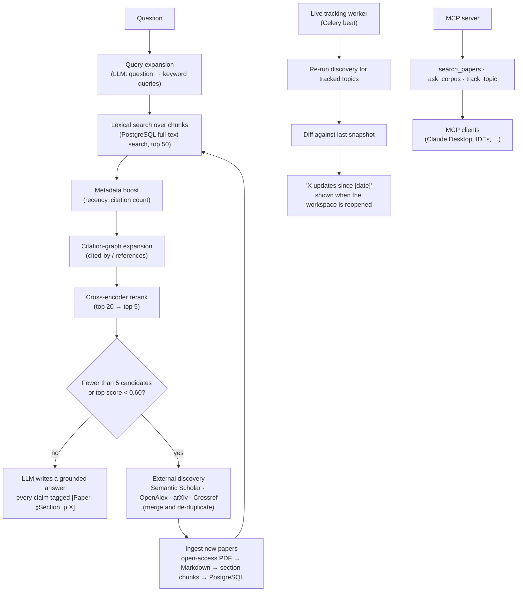

# IndexR: Project Overview

> IndexR finds the right research papers for your question, answers with citations you can trace to a section and page,
> and tells you what has changed in your topic since you last checked. It does this with lexical search, metadata,
> the citation graph and a reranker, without a vector database.

This document explains what IndexR is, how it works and how the codebase maps onto that design. For local setup, see
the [README](../README.md).

---

## 1. The problem

Researchers need precise answers that are spread across many papers, for example *"which of these methods report
F1 > 0.9 on this dataset?"* or *"how has this definition changed since 2019?"*. Today that means either reading PDFs one
at a time, or using tools such as NotebookLM, which:

- make the user **find and upload** every source themselves;
- rely on **vector embeddings**, which need dedicated infrastructure and can blur exact terms such as method names,
  dataset names and metric values;
- **go stale**: nothing tells the user that new work has appeared since they last looked.

IndexR closes three gaps in one workspace:

1. **Auto-discovery**: it finds relevant papers itself instead of waiting for uploads.
2. **Traceable answers**: every claim is cited as `[Paper, §Section, p.X]`, using lexical, graph and reranker-based
   ranking with no vector database.
3. **Live tracking**: reopening a workspace shows what is new since the last visit.

### Why vectorless?

Academic text is full of exact identifiers: model names, dataset names, units and numbers. Lexical matching handles
these better than embeddings. An embedding of *"F1 = 0.95"* sits very close to one of *"F1 = 0.82"*, because both mean
"an F1 score", so a vector search can confidently return the wrong paper. Lexical search rewards the exact token.

A vectorless design is also cheaper and simpler: there is no embedding cost and no separate vector database, and
updating the index is an ordinary database insert. The usual weakness of keyword search, different words for the same
idea, is handled by LLM query expansion and by a cross-encoder reranker that judges meaning.

---

## 2. How it works

### 2.1 Question answering, step by step

1. **Query expansion.** A fast LLM call turns the question into a few targeted keyword queries.
   *"What dataset has the best F1 score for MMLU?"* might become `["MMLU F1", "MMLU benchmark results", ...]`.
2. **Lexical search.** PostgreSQL full-text search returns the top ~50 chunks that match the keywords.
3. **Metadata boost.** A small formula nudges those scores by publication recency and citation count, so obscure or
   outdated papers do not outrank well-established ones that match equally well.
4. **Citation-graph expansion** *(P1).* Papers that cite, or are cited by, strong matches are pulled in as extra
   candidates.
5. **Cross-encoder rerank.** A dedicated cross-encoder (for example Cohere Rerank or a bge-reranker model) reads each
   candidate together with the question and scores it from 0 to 1. The top 5 go forward.
6. **Discovery gate.** If the local corpus cannot answer confidently, IndexR searches the external sources, ingests the
   new papers and repeats from step 2 (see §2.2).
7. **Grounded synthesis.** The LLM writes the answer using **only** the selected passages. Every claim carries a
   `[Paper, §Section, p.X]` tag that maps to a real chunk, so the UI can link straight to it. If the evidence is too
   thin, the answer says so instead of guessing.

### 2.2 When to look outside: the two-gate rule

BM25-style scores are unbounded, and their scale changes with the query and document lengths. A fixed threshold such
as "score < 50" would break on the next question. IndexR uses two gates instead:

| Gate | Check | Meaning |
|---|---|---|
| **1. Count** | Lexical search returns **fewer than 5** candidate chunks | The corpus has no coverage of this topic. The threshold matches the 5 passages the answer step needs. |
| **2. Confidence** | The best cross-encoder score is **below 0.60** | The words matched, but the content does not answer the question. |

If either gate fires, external discovery runs. Both thresholds are settings, to be tuned on the evaluation set.

### 2.3 Ingestion

1. **Fetch metadata** from the external sources and de-duplicate across them by DOI / arXiv ID / normalised title.
2. **Download the PDF**, only where a legal open-access copy exists (via Unpaywall / OpenAlex).
3. **Extract** the text as Markdown with `pymupdf4llm`, keeping page numbers and headings.
4. **Chunk by section**: a new chunk starts at every heading and ends at the next one. Sections longer than 1000
   characters are split further (at paragraphs, then lines, sentences and words) and keep their heading. Every chunk
   records its start and end page. Reference lists are kept out of the searchable chunks.
5. **Store** the chunks in PostgreSQL. A database trigger maintains a weighted full-text vector (heading = weight A,
   body = weight B) with a GIN index, so the new paper is searchable immediately.

---

## 3. Shared corpus: index once, reuse everywhere

IndexR **indexes** papers instead of fetching them live for every question. The external APIs mostly return metadata and
abstracts rather than full text, they are rate-limited, and they are too slow to call on every query.

- Every paper is parsed, chunked and stored **once** in a **shared corpus** that all users benefit from. The corpus is
  not per-user.
- Papers found algorithmically through the discovery sources are trusted and indexed automatically.
- Papers a user submits directly (an arbitrary DOI, URL or PDF) go to an **admin review queue** first, because they are
  unverified one-off submissions.
- Once indexed, a paper is reused for every later question, by every user.

---

## 4. Roles

**Regular user**

- Create a **workspace**: a topic-scoped space with its own paper set and chat.
- Ask questions, which triggers discovery, retrieval and a cited answer.
- View, add and remove papers in their own workspace.
- **Request** a specific paper (sent to the admin queue, not indexed instantly).
- Track a topic or paper, and see "X updates since [date]" on return.
- Browse chat history and click any citation to jump to the exact section and page.

**Admin** (a single admin role for the MVP)

- Approve or reject user-submitted papers.
- Browse and search the shared corpus; remove bad, duplicate or low-quality entries.
- Enable or disable external sources and manage their API keys.
- View indexing health: failed extractions and queue length (P2).
- Organisations and teams are not in the MVP, but the schema is ready for them.

---

## 5. Modules and priorities

**P0**: required for the MVP to work · **P1**: what makes the product different · **P2**: after the MVP

| Module | Features |
|---|---|
| **A. Discovery and shared corpus** | Query expansion (P0) · multi-source fetch with de-duplication by DOI/arXiv ID (P0) · auto-index discovered papers (P0) · user "request to add" → admin queue (P1) |
| **B. Ingestion and processing** | Open-access PDF fetch via Unpaywall/OpenAlex (P0) · text extraction with section/page boundaries (P0) · section-based chunking (P0) · reference parsing into citation edges (P1) |
| **C. Vectorless retrieval engine** | BM25-style search over chunks (P0) · metadata boosting (P0) · cross-encoder reranking (P0) · citation-graph expansion (P1) |
| **D. Answer synthesis and traceability** | Grounded answers that flag thin evidence (P0) · inline `[Paper, §Section, p.X]` citations with click-to-source (P0) · multi-paper comparison (P1) |
| **E. Workspace UI** | Workspace creation, streaming chat with citation chips (P0) · paper list panel (P0) · section-level source viewer (P1) |
| **F. Live tracking** | "Track this topic/paper" toggle (P1) · background re-poll and diff (P1) · "X updates since [date]" banner (P1) · LLM update digest (P2) |
| **G. MCP server** | `search_papers`, `ask_corpus` tools (P1) · auth scoped to the user's workspaces (P1) · `track_topic`, `get_citations` (P2) |
| **H. Auth and accounts** | Signup/login with JWT and per-user data scoping (P0) · `organization_id` reserved on `User` (P0) · org/team accounts (post-MVP) |
| **I. Admin panel** | Review queue (P1) · corpus browser (P1) · source toggles and key management (P1) · indexing health (P2) |

---

## 6. Tech stack

| Layer | Choice |
|---|---|
| Backend | Django + Django REST Framework |
| Database and full-text index | PostgreSQL: papers, chunks, citations, users and workspaces, with `SearchVector` / `SearchRank` and a GIN index |
| Citation graph | OpenAlex + Semantic Scholar data, stored as an edge table in PostgreSQL |
| Discovery sources | Semantic Scholar, OpenAlex, arXiv, Crossref |
| PDF extraction | `pymupdf4llm` (Markdown with headings and pages); GROBID if structure extraction needs to improve |
| Reranker | Cohere Rerank cross-encoder (`RerankService`, `rerank-v3.5`) |
| LLM | Pluggable provider interface (Claude, GPT or an open model), used for query expansion and synthesis |
| MCP server | Python `mcp` SDK, calling the same service layer as the API |
| Background jobs | Celery + Redis + `django-celery-beat` |
| Frontend | React (Vite) + Tailwind + shadcn/ui |
| Auth | Django auth + dj-rest-auth + `djangorestframework-simplejwt`, Google sign-in via django-allauth |

**A note on "BM25".** PostgreSQL's `ts_rank` is BM25-*style*: it uses term frequency and length normalisation but not
corpus-wide inverse document frequency. The cross-encoder compensates for much of the difference. If the evaluation
shows weak precision, the upgrade path is a true-BM25 PostgreSQL extension, which needs no new infrastructure.

---

## 7. Data model

| Model | App | Purpose |
|---|---|---|
| `User` | `iam` | Email-based account (no username) |
| `Workspace` | `workspaces` | A user's topic-scoped space; owns its chat and its paper list |
| `WorkspacePaper` | `workspaces` | The papers a workspace uses: cited papers are added automatically, and the user can add or remove papers (unique per workspace; a paper in use cannot be deleted). With `Workspace.papers_only` on, answers use only these. All papers ever cited are derived from `MessageCitation` |
| `Message` | `workspaces` | A chat message in a workspace (`user` or `assistant`) |
| `MessageCitation` | `workspaces` | A chunk an assistant message cites as `[n]` |
| `Paper` | `papers` | A paper: source, external ID, DOI, title, abstract, venue, citation count, publication date and precision, URLs, and when ingestion completed or failed (status is derived). With an `owner` it is a private upload only that user can see; without one it is in the shared corpus |
| `Author`, `PaperAuthor` | `papers` | Authors (with optional ORCID) and their order on each paper |
| `Chunk` | `papers` | A section-aligned piece of a paper: heading, text, page range, index, and a weighted full-text vector |
| `Citation` | `papers` | A paper → cited paper edge, used for graph expansion and for "new citations" in live tracking |
| `TrackedTopic` | `workspaces` | A query a workspace re-runs to find new papers (unique per workspace) |

**Planned:** update events for live tracking, the admin request queue, and `User.organization_id` (added with
organisations).

---

## 8. What exists in the codebase

| Area | Where | Status |
|---|---|---|
| Signup, email verification, login (JWT with refresh-token rotation and blacklist), Google sign-in | `iam/`, `webapp/src/pages/auth`, `webapp/src/api` | Done |
| Core models: papers, authors, chunks, workspaces, messages, workspace papers | `papers/models.py`, `workspaces/models.py` | Done |
| Full-text index on chunks (weighted trigger + GIN) | `papers/migrations/0002_add_search_vector_trigger.py` | Done |
| Paper fetchers for arXiv, OpenAlex and Semantic Scholar, plus an orchestrator that queries them in parallel and de-duplicates | `papers/services/fetchers/` | Done |
| PDF extraction and section-based chunking (`TextExtractorService`) and chunk storage (`Paper.replace_chunks`) | `papers/services/`, `papers/models.py` | Done |
| Storing fetched papers and authors without duplicates (`PaperStoreService`), PDF download (`PdfDownloadService`) | `papers/services/` | Done |
| Chunk search endpoint `GET /api/papers/chunks/search/?q=` with recency/citation boost and year, venue and citation filters (`Chunk.objects.search`, `filter_papers`) | `papers/` | Done |
| Pluggable LLM interface (`LLMService`, pydantic-ai, `LLM=<provider>:<model>`) | `server/services/` | Done |
| Celery + Redis worker, `ingest_paper` task (download → extract → store chunks), queued when a new paper with a PDF is stored | `server/celery.py`, `papers/tasks.py` | Done |
| LLM query expansion (`QueryExpansionService`) and Cohere cross-encoder reranker (`RerankService`) | `papers/services/` | Done |
| Workspace CRUD API `/api/workspaces/`, scoped to the caller | `workspaces/` | Done |
| Workspace papers `/api/workspaces/<id>/papers/` (list, add, remove) and chat messages `/api/workspaces/<id>/messages/` (list, post) | `workspaces/` | Done |
| Permissions: shared `BasePermission` (login required, plus per-request and per-object hooks), `IsOwner`; `UserScopedMixin` scopes views to the caller | `server/permissions.py`, `iam/` | Done |
| Workspace dashboard UI | — | Planned |
| Discovery (`DiscoveryService`: expanded queries → all sources → dedupe → abstract filter with Cohere → store and queue ingestion) | `papers/services/` | Done |
| Corpus check before discovery (`RetrievalService`: multi-query search → rerank → two-gate `needs_discovery`, thresholds in settings) | `papers/services/` | Done |
| Grounded answers (`AnswerService`: numbered passages → LLM → `[n]` markers mapped to chunks, `Chunk.citation` labels) | `papers/services/` | Done |
| Ask: `POST /api/workspaces/<id>/messages/` (JSON) and `…/messages/stream/` (server-sent events) run expand → search → discover and wait for ingestion if needed → rerank → answer, saving the assistant message with its `MessageCitation`s (`AskService`) | `workspaces/` | Done |
| Workspace UI: workspaces list (search, grouped by activity), chat with streamed cited answers, papers panel (user's papers with the "answer only from these papers" switch, and papers mentioned by answers via `GET /api/workspaces/<id>/mentioned-papers/`), settings | `webapp/` | Done |
| Private uploads: `POST /api/papers/` (multipart PDF) extracts a paper only its uploader can see; every search, retrieval and workspace add is limited to `Paper.objects.visible_to(user)` | `papers/`, `webapp/` | Done |
| Admin: papers (search, visibility filter, delete), authors and workspaces in the Django admin | `papers/admin.py`, `workspaces/admin.py` | Done |
| MCP, live tracking | — | Planned |

The service classes are independent of the HTTP layer, so the API, background jobs and the MCP server can all call the
same code.

---

## 9. Roadmap

| Weeks | Focus |
|---|---|
| 1 | Foundations and auth: Django/DRF skeleton, PostgreSQL models, JWT with per-user scoping, external API integration (raw fetch) |
| 2–3 | Vectorless retrieval core: full-text ranking, section chunking, metadata boosting, a raw query endpoint (no LLM yet, to validate retrieval first) |
| 3–4 | Auto-discovery: query expansion, multi-source merge and de-duplication, auto-indexing into the shared corpus |
| 4–5 | Reranking and synthesis: cross-encoder reranker, grounded answers with enforced citations, citation-graph expansion |
| 5–6 | Workspace UI: workspaces, streaming chat with citation chips, paper list panel |
| 6–7 | Admin panel and manual requests: review queue, corpus browser, source management |
| 7–8 | MCP server: `search_papers` / `ask_corpus`, auth-scoped |
| 8–9 | Live tracking: track toggle, background poller, diff engine, "X updates since" banner |
| 9–10 | Hardening: error handling, cost/latency guardrails, evaluation set |

**Demo milestone:** weeks 1–6 already make a usable product: ask a question, watch IndexR discover papers, get a cited
answer and browse the workspace. The admin panel, MCP and live tracking are layered on top.

---

## 10. Out of MVP scope

- Organisation/team accounts, roles and seats (the schema is ready; nothing is built)
- A citation-graph visualisation UI
- Several users collaborating on one workspace
- A custom or fine-tuned reranker
- Table and figure extraction
- Paywalled papers (open access only)

## 11. Success metrics

- **Retrieval precision:** the correct evidence is in the top 5 passages for at least 80% of a 20–30 question
  evaluation set.
- **Citation accuracy:** no invented section or page on manual spot-checks.
- **Discovery relevance:** at least 70% of auto-sourced papers judged relevant.
- **Live tracking:** diffs match manual verification, with no false "updates".
- **Latency:** roughly 8–12 seconds per answer on a warm workspace.
